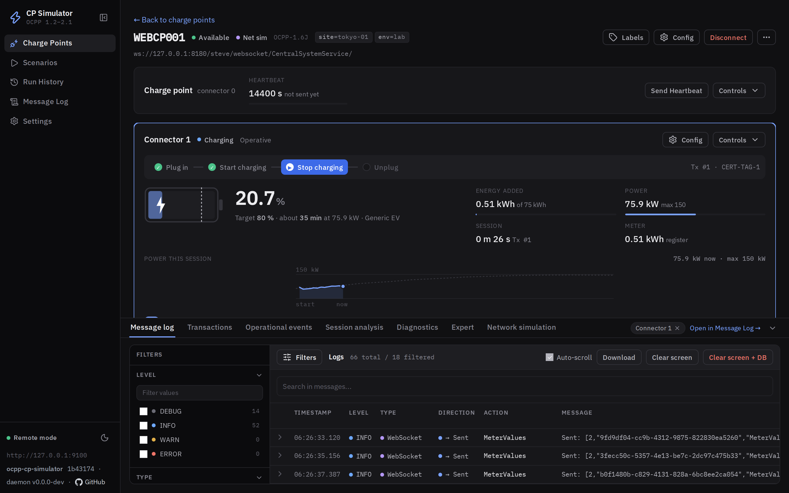

# OCPP CP Simulator

[](https://deepwiki.com/shiv3/ocpp-cp-simulator)

OCPP 1.6J charge point simulator for **AI agent testing**, CI automation, and CSMS development. Comes with a browser UI, a headless CLI, and a Socket.IO control API that any agent or script can drive. Also speaks OCPP 2.0.1 / 2.1 (WebSocket) and OCPP 1.2 / 1.5 / 1.6S (SOAP).

| Interface   | Description                                             | Docs                                                                                      |
| ----------- | ------------------------------------------------------- | ----------------------------------------------------------------------------------------- |
| **Browser** | Web console at `/` / Tauri desktop app                  | [Web console](docs/entities/web-console.md) · [Desktop app](docs/entities/desktop-app.md) |
| **CLI**     | Headless mode for scripting, CI, and AI integration     | [CLI](docs/entities/cli.md)                                                               |
| **Server**  | Long-running Socket.IO server, multi-CP per process     | [Daemon](docs/entities/daemon.md) · [Control plane](docs/concepts/control-plane.md)       |
| **Docker**  | Pre-built image (daemon + web console) on GHCR          | [Docker image](docs/entities/docker-image.md)                                             |
| **MCP**     | `POST /mcp` tools for Claude Code and other MCP clients | [MCP endpoint](docs/entities/mcp-endpoint.md)                                             |



See the [web console tour](#web-console-tour) for each feature in action.

## Quick Start

```bash
# Install dependencies
npm install

# Browser UI (dev server)
npm run dev

# CLI / Server mode (requires Bun)
ocpp-cp-sim --ws-url ws://localhost:9000/ocpp --cp-id CP001
```

### Install as a global command (`ocpp-cp-sim`)

```bash
# pnpm (recommended)
pnpm install -g https://github.com/shiv3/ocpp-cp-simulator/releases/download/cli-latest/ocpp-cp-simulator.tgz

# bun
bun install -g https://github.com/shiv3/ocpp-cp-simulator/releases/download/cli-latest/ocpp-cp-simulator.tgz

# From a local checkout
bun link              # in this repo
bun link ocpp-cp-simulator   # in any other project
```

> Every install command above is fetched by CI, so a URL printed here resolves. Do **not** use GitHub's `releases/latest/download/…` — this repo has two tag trains (`v*` desktop, `cli-v*` CLI) and "latest" resolves across both, landing on a desktop release that carries no `.tgz`.
>
> `releases/download/cli-latest/ocpp-cp-simulator.tgz` is a rolling pre-release the `Release CLI` workflow moves onto every stable CLI release (a SemVer prerelease such as `cli-v1.0.0-rc.1` is skipped), so the commands above always install the newest stable CLI. To pin a version, use that release's own asset instead, e.g. `releases/download/cli-v0.4.0/ocpp-cp-simulator-0.4.0.tgz`. See [docs/entities/cli.md](docs/entities/cli.md#why-cli-latest-and-not-releaseslatest).
>
> The release tarballs are produced by the `Release CLI` workflow on `cli-v*` tags. A bare `bun install -g github:shiv3/ocpp-cp-simulator` does **not** work — `dist/` is built at release time, not committed, and bun doesn't install devDependencies for global packages so the on-install `vite build` can't run.

Then run from anywhere:

```bash
# Interactive REPL against a CSMS
ocpp-cp-sim --ws-url ws://localhost:9000/ocpp --cp-id CP001

# Headless daemon (Socket.IO control API only)
ocpp-cp-sim --daemon --http-port 9700

# Daemon + bundled browser UI on the same origin
#   open http://127.0.0.1:5172 to drive the daemon from the web console
ocpp-cp-sim --http-port 5172 --web-console \
            --cp-id CP001 --connectors 2 \
            --ws-url wss://csms.example.com/ocpp/

# Full kitchen-sink: persistent SQLite, JSON-line logs, demo scenario auto-loaded
ocpp-cp-sim --http-port 5172 --web-console \
            --cp-id CP001 --connectors 5 \
            --ws-url wss://csms.example.com/ocpp/ \
            --scenario-template-file docs/examples/scenarios/demo-charging.json \
            --scenario-connector all \
            --state-db ./state.db --log-format json
```

`--web-console` serves the browser UI (built into `dist/` and shipped inside the release tarball) from the same HTTP port as the Socket.IO control plane, so a single port is all you need to expose. See [CLI](docs/entities/cli.md) for the full flag reference and [Control plane](docs/concepts/control-plane.md) for the Socket.IO protocol.

> **Behind a reverse proxy?** Bound to a non-loopback host the daemon applies a safe same-origin CORS policy, so the web console served at a public URL will `403` its own assets until you name that origin with `--cors-origin https://your.url` (or, behind a trusted proxy, `--trust-forwarded-headers`). See [Access control → Behind a reverse proxy](docs/concepts/access-control.md#behind-a-reverse-proxy-traefik-nginx-caddy-) for details and an nginx + Authelia example compose.

## Documentation

`docs/` is organized as an [LLM Wiki](https://gist.github.com/karpathy/442a6bf555914893e9891c11519de94f): an interlinked knowledge base maintained by an LLM agent under the schema in [`CLAUDE.md`](CLAUDE.md).

- **Start here:** [Overview](docs/overview.md) · [Index of all pages](docs/index.md) · [Choosing an interface](docs/analyses/choosing-an-interface.md)
- **Entities** — [CLI](docs/entities/cli.md), [analyze](docs/entities/analyze.md), [Daemon](docs/entities/daemon.md), [Web console](docs/entities/web-console.md), [Desktop app](docs/entities/desktop-app.md), [Docker image](docs/entities/docker-image.md), [MCP endpoint](docs/entities/mcp-endpoint.md), [Scenario templates](docs/entities/scenario-templates.md), [CSMS peers](docs/entities/csms-peers.md), [Open EV Directory](docs/entities/open-ev-directory.md)
- **Concepts** — [Control plane](docs/concepts/control-plane.md), [Scenario format](docs/concepts/scenario-format.md), [Trace format](docs/concepts/trace-format.md), [State persistence](docs/concepts/state-persistence.md), [Log format](docs/concepts/log-format.md), [Network simulation](docs/concepts/network-simulation.md), [Access control](docs/concepts/access-control.md), [OCPP versions & transports](docs/concepts/ocpp-versions-and-transports.md), [Security profiles](docs/concepts/security-profiles.md), [Local vs Remote mode](docs/concepts/local-vs-remote-mode.md), [Vehicle profiles](docs/concepts/vehicle-profiles.md)
- **Analyses** — [Driving from an AI agent](docs/analyses/driving-from-an-ai-agent.md), [REST → Socket.IO migration](docs/analyses/rest-to-socketio-migration.md), [Testing strategy](docs/analyses/testing-strategy.md)
- **Sources** — summaries of the raw inputs (JSON schemas, example files, sibling READMEs, issues): [docs/sources/](docs/index.md#sources-sources)

Also browsable at https://deepwiki.com/shiv3/ocpp-cp-simulator.

## Highlights

- **AI agent & automation testing** — structured JSON logs, one Socket.IO `rpc`/`event` contract, an MCP endpoint, runtime-injected scenario templates with machine-readable verdicts, an unauthenticated health probe, and SQLite persistence. Minimal recipe and client options: [Driving from an AI agent](docs/analyses/driving-from-an-ai-agent.md).
- **SOAP versions (1.2, 1.5, 1.6S)** — full bidirectional OCPP-S in CLI / server mode, send-only in the browser: [OCPP versions & transports](docs/concepts/ocpp-versions-and-transports.md).
- **OCPP 1.6 security profiles 1–3** — Basic Auth with `AuthorizationKey`, server-certificate verification, mutual TLS: [Security profiles](docs/concepts/security-profiles.md).
- **Network simulation** — seeded latency / jitter, forced and periodic disconnects, delayed reconnect, configured at runtime: [Network simulation](docs/concepts/network-simulation.md).
- **Certification scenarios** — 47 `cert16-*` templates covering the OCPP 1.6 test cases, verified against SteVe: [Scenario templates](docs/entities/scenario-templates.md).
- **Diagnostics** — versioned OCPP trace files and DebugKit reports via `ocpp-cp-sim analyze`: [analyze](docs/entities/analyze.md).
- **Persistence** — the browser (sql.js + IndexedDB) and the daemon (`--state-db`) share one SQLite schema: [State persistence](docs/concepts/state-persistence.md).
- **Local vs Remote mode** — the browser decides once per load by probing `/v1/healthz`: [Local vs Remote mode](docs/concepts/local-vs-remote-mode.md).

## Web console tour

Recorded from the daemon's web console in Remote mode, with two charge points (`WEBCP001`, `WEBCP002`, OCPP 1.6J) connected to [SteVe](https://github.com/steve-community/steve) 3.14.1. Each recording plays inline on GitHub (click to play).

### Settings: TagIDs and network simulation

The TagIDs the connector card offers for **Start charging** (here the ones SteVe knows), and the global network-simulation layer.

https://github.com/user-attachments/assets/b79b0bb3-5172-4cfe-a376-9bd89232930b

<details>
<summary>Screenshots</summary>


</details>

### Fleet: charge points, connectors and labels

Every charge point the daemon runs, as a hierarchy, a charge point list or a connector list, filtered by status, OCPP version or label (`site=tokyo-01`).

https://github.com/user-attachments/assets/bae86d0e-40f5-41a7-a8fc-102b38b26296

<details>
<summary>Screenshots</summary>


</details>

### A charging session from the connector card

**Plug in → Start charging → Stop charging**: the connector card drives a real OCPP 1.6J transaction against SteVe, with the auto meter feeding power, energy and SoC; the **Transactions** tab keeps the session.

https://github.com/user-attachments/assets/ddc2b067-2c41-4a48-ab4d-12adf82e0df6

<details>
<summary>Screenshots</summary>


</details>

### Remote start from the CSMS

SteVe sends **RemoteStartTransaction**; the charge point's _Essential CP Behavior_ scenario plugs in, starts the transaction and meters it, and the operational timeline records each step.

https://github.com/user-attachments/assets/8c75baf7-67d1-415d-8c4e-a9c6c1419afd

<details>
<summary>Screenshots</summary>


</details>

### Labels, edited in place

Relabel a charge point from its header (`cp.labels.set`): no reconnect, the chips update at once.

https://github.com/user-attachments/assets/24f75863-1b95-4ceb-b0f9-15d004d11828

<details>
<summary>Screenshots</summary>


</details>

### Network faults and recovery

Per-charge-point rules (here a 300 ms latency and a manual disconnect); the **Operational events** tab ties the injected fault, the reconnect, the boot and `recovery_completed` into one incident.

https://github.com/user-attachments/assets/dd905829-4e6c-4448-a955-36c48dcf8ea9

<details>
<summary>Screenshots</summary>


</details>

### Expert: any station-initiated call

Send any OCPP call the station can send (here a DataTransfer) through the live connection and see the CSMS's answer.

https://github.com/user-attachments/assets/e503d6dd-bc22-45eb-b1d2-abe1a84f900e

<details>
<summary>Screenshots</summary>


</details>

### Session analysis

OCPP DebugKit's failure-pattern analysis over the charge point's stored logs, in the browser.

https://github.com/user-attachments/assets/25bbd716-5ccc-4790-9f75-d2afc0810f77

<details>
<summary>Screenshots</summary>


</details>

### Scenarios

Running scenarios per connector and their steps, the template library (54 templates), and the scenario editor's steps and graph views.

https://github.com/user-attachments/assets/f4711591-40b3-489e-8014-b2ddb3940ad7

<details>
<summary>Screenshots</summary>


</details>

### Run history and message log

Past scenario runs with their verdicts, and every OCPP frame across charge points, filterable by charge point, level, type and connector.

https://github.com/user-attachments/assets/9d074d50-8583-4ccd-ace1-e3c77be45f64

<details>
<summary>Screenshots</summary>


</details>

## Contributing

Before pushing, run the checks CI runs: `bun run lint`, `bun run format:check`, `bun run typecheck` and `bun run test` ([Testing strategy](docs/analyses/testing-strategy.md)). Type errors fail the build.

`CLAUDE.md` is the schema for the documentation wiki (layers, layout, ingest / query / lint workflows); `docs/conventions.md` holds the page conventions. When a change alters behaviour, update the affected wiki pages, `docs/index.md` and `docs/log.md` in the same PR.
